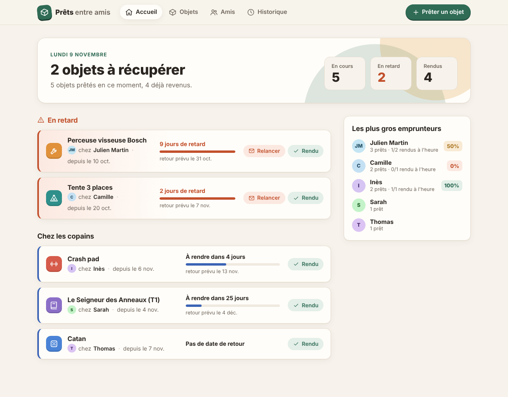
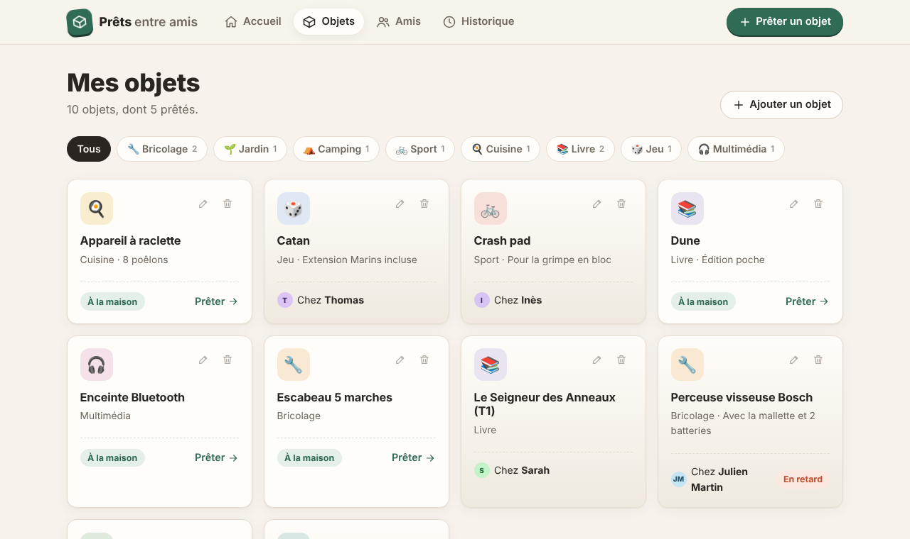
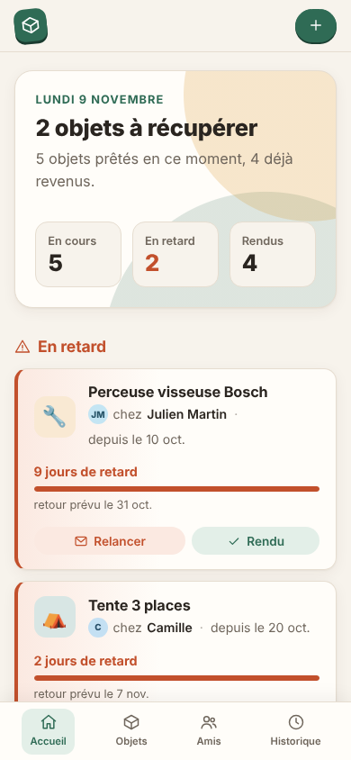

# 📦 Prêts entre amis


**Qui a emprunté ma perceuse ?** Une petite application web pour suivre les objets qu'on prête à ses proches : qui a quoi, depuis quand, et qui est en retard.

Construite avec **Symfony 7.4 (LTS)**, **Doctrine ORM 3** et **MySQL 8.4**. Le design est fait main en CSS, sans framework, avec mode sombre et version mobile.



<p align="center">
  
  &nbsp;
  
</p>

## Fonctionnalités

- **Accueil** : les prêts en retard d'abord, avec une barre d'avancement par prêt, un bouton *Rendu* et un bouton *Relancer* qui prépare un e-mail de rappel. Plus un classement des emprunteurs et de leur ponctualité.
- **Objets** : classés par catégorie (bricolage, jardin, livres…), on voit d'un coup d'œil ce qui est à la maison et ce qui est chez quelqu'un.
- **Amis** : coordonnées, prêts en cours et au total, avatar coloré généré à partir du nom.
- **Historique** : tous les prêts, filtrables par ami et par statut.

## Lancer le projet

Avec Docker, rien d'autre à installer :

```bash
docker compose up -d
```

Ouvre ensuite http://localhost:8080. Au premier démarrage, le conteneur installe les dépendances Composer, applique les migrations et charge des données de démo (compte une ou deux minutes).

| Action | Commande |
|---|---|
| Arrêter | `docker compose down` |
| Repartir de zéro | `docker compose down -v && docker compose up -d` |
| Recharger les données de démo | `docker compose exec app php bin/console app:demo:load --purge` |
| Console Symfony | `docker compose exec app php bin/console` |

## Tests

```bash
docker compose exec app vendor/bin/phpunit --testdox
```

La base `prets_test` est recréée à partir des migrations à chaque lancement. Les 15 tests couvrent trois niveaux :

- **Unitaires** : calcul du statut (en cours / en retard / rendu), avancement du prêt, impossibilité de rendre deux fois.
- **Intégration** sur MySQL : refus d'un double prêt par le service *et* par la base elle-même, retour puis nouveau prêt, statistiques.
- **Fonctionnels** avec le navigateur de test de Symfony : toutes les pages s'affichent, ajout d'un ami avec erreur de validation, retour d'un prêt depuis l'accueil.

La CI GitHub Actions lance aussi `lint:twig`, `lint:yaml`, `lint:container` et `doctrine:schema:validate` à chaque push.

## Choix techniques

| Sujet | Choix | Pourquoi |
|---|---|---|
| **Un objet ne peut pas être prêté deux fois** | Colonne générée MySQL `active_item_id` (= `item_id` tant que le prêt n'est pas rendu) + index `UNIQUE` | La règle est garantie par la base, même en cas de requêtes simultanées. Le service `LoanManager` vérifie aussi en amont avec un verrou `SELECT … FOR UPDATE`, pour renvoyer un message clair. |
| **Colonne générée et Doctrine** | Créée dans la migration ; un listener `postGenerateSchema` la déclare dans le schéma attendu | Doctrine ne sait pas comparer les colonnes générées : sans ça, `schema:validate` échouerait et `migrations:diff` proposerait de la supprimer. |
| **Statut d'un prêt** | Calculé (`Loan::getStatus()` en PHP, `CASE` en DQL pour les filtres), jamais stocké | Un prêt devient « en retard » tout seul à minuit, sans tâche planifiée ni risque de désynchronisation. |
| **Catégories** | Enum PHP `ItemCategory` mappée par Doctrine (`enumType`) | Typage fort de bout en bout : base, entité, formulaire (`EnumType`) et templates. |
| **Intégrité** | Clés étrangères `RESTRICT`, contraintes `CHECK` sur les dates, `UniqueEntity` sur le nom des amis | La validation Symfony donne de jolis messages ; la base garantit la cohérence quoi qu'il arrive. |
| **Sécurité** | Jetons CSRF sur tous les formulaires et boutons d'action, échappement Twig automatique, requêtes paramétrées | Les bases. |
| **Front** | Twig + CSS natif (variables, `color-mix`, grid) + 30 lignes de JS en amélioration progressive | Pas de build front à maintenir ; tout fonctionne sans JavaScript. |

## Structure

```
├── config/               configuration Symfony (Doctrine, Twig…)
├── docker/               script de démarrage du conteneur
├── migrations/           migrations Doctrine
├── public/               index.php, CSS, JS
├── src/
│   ├── Command/          app:demo:load (données de démo)
│   ├── Controller/       Accueil, Objets, Amis, Prêts
│   ├── Entity/           Friend, Item, Loan
│   ├── Enum/             ItemCategory, LoanStatus
│   ├── EventListener/    déclaration de la colonne générée pour Doctrine
│   ├── Form/             formulaires Symfony
│   ├── Repository/       requêtes DQL
│   ├── Service/          LoanManager (règles métier des prêts)
│   └── Twig/             filtres : dates en français, initiales, couleur d'avatar…
├── templates/            vues Twig
└── tests/                Unit/, Integration/, Functional/
```

## Pistes d'évolution

- [ ] Comptes utilisateurs (Symfony Security) pour que chacun gère ses propres prêts
- [ ] Rappel automatique par e-mail aux retardataires (Symfony Mailer + Scheduler)
- [ ] Photos des objets
- [ ] Prolonger un prêt
