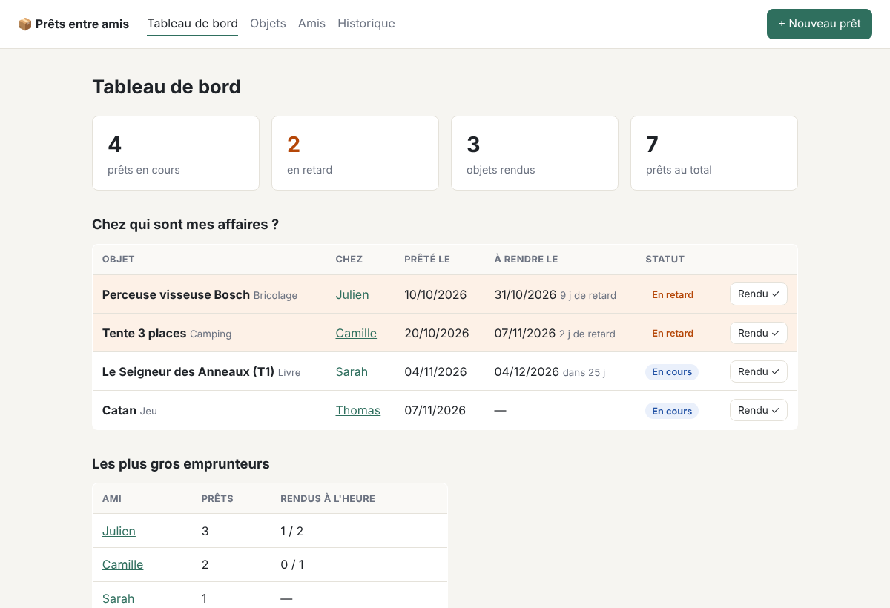
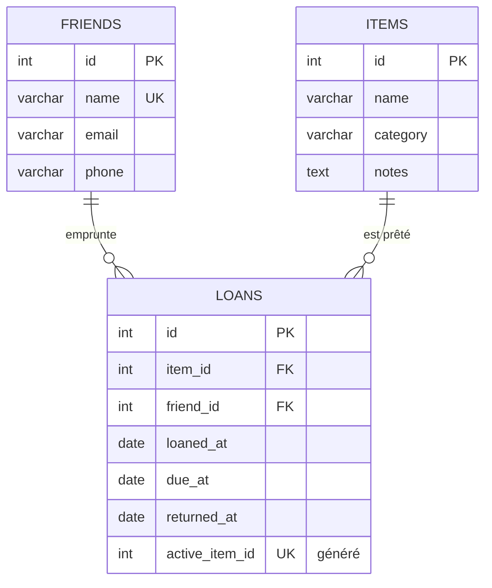

# 📦 Prêts entre amis


**Qui a emprunté ma perceuse ?** Petite application web pour suivre les objets prêtés à ses proches : qui a quoi, depuis quand, et qui est en retard.

PHP 8.3 natif (sans framework) et MySQL 8. Le projet montre une architecture propre sans dépendances : routeur maison, repositories PDO, contrôleurs et vues séparés.



## Fonctionnalités

- **Tableau de bord** : prêts en cours triés par urgence, retards mis en évidence, statistiques, classement des emprunteurs avec leur taux de retour à l'heure
- **Objets** : CRUD, filtre par catégorie, emplacement actuel de chaque objet (à la maison ou chez qui)
- **Amis** : CRUD, nombre de prêts en cours et au total
- **Prêts** : création en un clic depuis un objet ou un ami, retour en un clic, historique filtrable par ami et par statut

## Lancer le projet

```bash
docker compose up -d
```

Ouvre ensuite http://localhost:8080. La base est créée et remplie avec des données de démo au premier lancement.

Pour repartir de zéro : `docker compose down -v && docker compose up -d`.

<details>
<summary>Sans Docker</summary>

```bash
mysql -u root -p -e "CREATE DATABASE prets CHARACTER SET utf8mb4"
mysql -u root -p prets < database/schema.sql
mysql -u root -p prets < database/seed.sql

DB_USER=root DB_PASSWORD=secret php -S localhost:8000 -t public public/index.php
```
</details>

## Tests

```bash
composer install
vendor/bin/phpunit --testdox
```

- **Unitaires** : routeur (paramètres, 404, 405) et validation des saisies (dates impossibles, entiers).
- **Intégration** sur une vraie base MySQL (`prets_test`, recréée à chaque lancement) : refus d'un double prêt, retour unique puis nouveau prêt possible, calcul du statut « en retard ».

Ils tournent automatiquement sur GitHub Actions à chaque push, avec un service MySQL 8.4.

## Modèle de données



## Choix techniques

| Sujet | Choix | Pourquoi |
|---|---|---|
| **Un objet ne peut pas être prêté deux fois** | Colonne générée `active_item_id` (= `item_id` si non rendu, sinon `NULL`) + index `UNIQUE` | La règle est garantie par la base elle-même, même en cas de requêtes concurrentes ou d'insertion hors application. Le code PHP vérifie aussi en amont avec un `SELECT … FOR UPDATE` dans une transaction pour renvoyer un message clair. |
| **Statut du prêt** (en cours / en retard / rendu) | Calculé en SQL (`CASE`), jamais stocké | Un statut stocké finit toujours désynchronisé : un prêt devient « en retard » à minuit sans que personne ne le mette à jour. |
| **Intégrité** | Clés étrangères `ON DELETE RESTRICT`, contraintes `CHECK` sur les dates | On ne peut pas supprimer un ami ou un objet qui a un historique. L'erreur SQL 23000 est interceptée et transformée en message lisible. |
| **Sécurité** | Requêtes préparées partout, échappement HTML systématique (`e()`), jeton CSRF sur tous les POST, cookie de session `HttpOnly` + `SameSite=Lax` | Les bases contre l'injection SQL, le XSS et le CSRF. |
| **Formulaires** | Pattern Post/Redirect/Get (303) + messages flash, ré-affichage avec erreurs en 422 | Pas de double soumission au rafraîchissement, et des codes HTTP justes. |
| **Sans framework** | Autoloader PSR-4 de 10 lignes, routeur de 50 lignes | Montrer ce qu'un framework fait à notre place. |

## Structure

```
├── database/        schéma SQL + données de démo
├── public/          point d'entrée (index.php), CSS, .htaccess
├── src/
│   ├── Controller/  un contrôleur par ressource
│   ├── Repository/  tout le SQL est ici
│   ├── Router.php   routage méthode + chemin, paramètres {id}
│   ├── View.php     rendu des templates dans le layout
│   └── Csrf.php, Flash.php, Input.php, helpers.php
├── templates/       vues PHP
└── tests/           Unit/ et Integration/ (PHPUnit 11)
```

## Pistes d'évolution

- [x] Tests PHPUnit et CI GitHub Actions
- [ ] Rappel par e-mail aux amis en retard (tâche cron)
- [ ] Comptes utilisateurs pour que chacun gère ses propres prêts
- [ ] Photos des objets
- [ ] Prolonger un prêt
